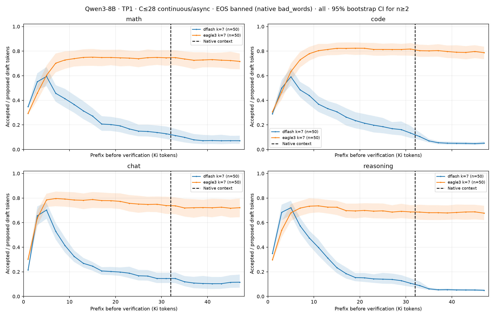
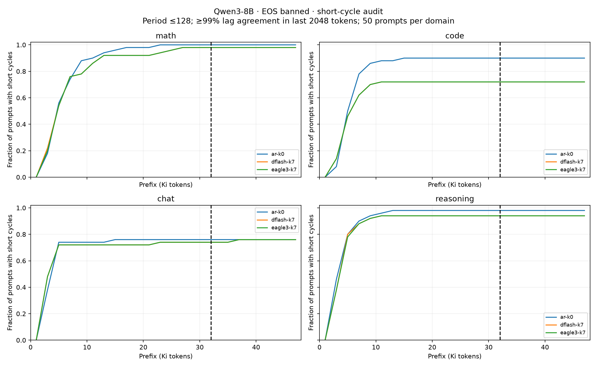
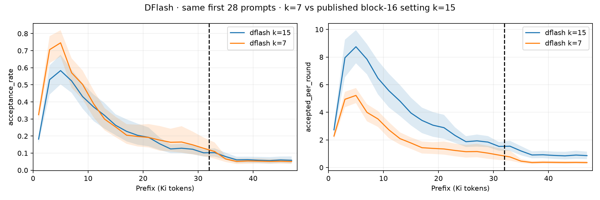

# Qwen3-8B: acceptance до 1,5× нативного контекста, с запретом EOS

Эксперимент [#11](https://github.com/PavelPaha/specdec_research/issues/11) завершён
28 октября 2026 года. Основной набор: **200 промптов × 3 метода**, ещё 28
продолжений в контроле бюджета DFlash. Получено **30 723 162 новых токена**.
Все 628 последовательностей достигли **49 152 суммарных токенов**; выданных
EOS, NaN в логитах и вытеснений из KV-кеша — **0**. Обе B300 освобождены.

**DFlash теряет acceptance уже после 4–6 Ki токенов, задолго до нативной
границы 32 Ki. EAGLE-3 в этом режиме сохраняет гораздо более высокий acceptance.**
Разрыв остаётся на 197 примерах с полностью совпавшими выходными token IDs.
При этом **все 628 конечных хвостов — точные циклы обычного текста**.
Запрет EOS убрал EOS, но не вырождение принудительного продолжения.

Это стресс-тест растущей генерации, а не оценка качества реальных длинных
рассуждений или агентных трейсов. [Полный протокол](protocol.md) описывает
данные, закреплённые версии, метрики и ограничения.

## Acceptance и граница контекста

Acceptance — принятые / предложенные draft-токены, без бонусного target-токена.
Сначала считаются отношения для каждого промпта, затем их среднее; Ki = 1024 токена.
Каждый основной срез содержит все 200 промптов, по 50 каждого домена.

| Метод | Префикс 4–8 Ki | Префикс 44–48 Ki | Парное изменение, п.п. | 95% bootstrap CI изменения |
| --- | ---: | ---: | ---: | ---: |
| DFlash k=7 | 54,7% | 7,1% | −47,61 | [−50,86; −44,28] |
| EAGLE-3 k=7, цепочка | 69,8% | 72,8% | +3,04 | [−0,08; +6,34] |



| Источник промпта | DFlash: 4–8 → 44–48 Ki | EAGLE-3: 4–8 → 44–48 Ki |
| --- | ---: | ---: |
| Математика, MATH-500 | 48,0% → 7,1% | 63,7% → 72,0% |
| Код, HumanEval | 49,6% → 4,9% | 67,0% → 79,2% |
| Чаты, UltraChat | 59,6% → 11,4% | 78,9% → 71,9% |
| Другие рассуждения, BBH | 61,7% → 5,1% | 69,5% → 68,2% |

После 32 Ki есть дополнительное снижение, но основная деградация DFlash
началась раньше. При сравнении окон **28–32 Ki и 32–36 Ki**:

- DFlash: **13,47% → 9,75%**, −3,72 п.п., CI [−5,24; −2,55].
- EAGLE-3: **74,84% → 73,82%**, −1,03 п.п., CI [−1,78; −0,40].

Падение более чем на 50 п.п. между ранним и поздним окнами встречается
у **102/200** примеров DFlash и **6/200** EAGLE-3.
Все индивидуальные изменения: [CSV](per_prompt_changes.csv);
доменные срезы и интервалы: [CSV](paired_changes.csv).

У DFlash и EAGLE-3 **197/200 полных продолжений совпали по хешам token IDs**.
На этом поднаборе DFlash даёт **54,4% → 7,1%**, EAGLE-3 — **70,1% → 73,1%**:
[отдельный расчёт](identical_trajectory_changes.csv).
Различаются `math-000`, `code-000`, `reasoning-049`.
Это исключает различие выданного текста как единственное объяснение разрыва
на 197 парах. Однако начала раундов проверки различаются; фиксированного
teacher-forced сравнения на каждой одинаковой позиции здесь нет.

## Скорость всей очереди

Qwen3-8B BF16, vLLM 0.32.0, **TP1**, continuous batching **C≤28**.
Каждый метод генерирует ровно **9 784 196** токенов на одной B300.

| Метод | Генерация, мин | Суммарные ток/с | Отношение к AR |
| --- | ---: | ---: | ---: |
| AR, без спекуляции | 112,50 | 1449,46 | 1,00× |
| DFlash k=7 | 95,26 | 1711,90 | 1,18× |
| EAGLE-3 k=7 | 30,83 | 5289,43 | 3,65× |

Загрузка и компиляция модели исключены; prefill, логирование, заполнение
и опустошение очереди включены. Это суммарный throughput, не ток/с одного запроса.
Низкий acceptance DFlash в этом запуске **не превратился в замедление полной
очереди относительно AR**, хотя выигрыш оказался небольшим.

[Скорость по длине префикса](speedup_vs_ar_all.png) считается по времени
поступления токенов каждого запроса. Она зависит также от состава батча.
С AR не совпало ни одно полное продолжение обоих спекулятивных методов;
причину этих расхождений отдельно не изолировали. Поэтому отношение скоростей
описывает эти очереди, а не чистую стоимость проверки на идентичном тексте.
Повторных независимых замеров скорости не было. [Точные числа](throughput.csv).

## Что произошло после запрета EOS

EOS `151643` и `151645` запрещены штатным `SamplingParams.bad_words` при
greedy-генерации с `ignore_eos=True`. Target выбирает наиболее вероятный
разрешённый токен. Драфтеры не изменены: они могут предлагать EOS, который
будет отвергнут. Реальных draft IDs в V2-трассе нет, поэтому долю таких
отказов отдельно измерить не удалось.

| Запуск | Точные короткие циклы в конце | Дополнительные точные длинные циклы | Всего циклических хвостов | EOS |
| --- | ---: | ---: | ---: | ---: |
| AR | 182 | 18 | 200/200 | 0 |
| DFlash k=7 | 170 | 30 | 200/200 | 0 |
| EAGLE-3 k=7 | 170 | 30 | 200/200 | 0 |
| DFlash k=15, контроль | 23 | 5 | 28/28 | 0 |

Короткие циклы: периоды 1–128 на последних 2048 токенах. Для пропущенных
конечных хвостов проверены периоды 129–2048 на последних 8192 токенах.
Во всех перечисленных случаях совпадение с периодом равно **100%**.
[Аудит коротких циклов](cycles_summary.json),
[длинных хвостов](long_tail_audit.csv),
[контроля k=15](control_long_tail_audit.json).



Фильтр только коротких циклов оставляет повторяющиеся длинные блоки.
Например, у контроля `code-000` период равен 302 токенам, у трёх чатов —
191, 206 и 225. Поэтому [кривая без обнаруженных коротких циклов](acceptance_without_short_cycles.png)
**не является кривой на заведомо осмысленных продолжениях**. В поздних
математических срезах после этого фильтра остаётся всего один промпт.
Риск повторений при greedy thinking также отмечен в
[карточке Qwen3](https://huggingface.co/Qwen/Qwen3-8B#best-practices).

Примеры сильного падения DFlash; числа относятся к окнам 4–8 и 44–48 Ki:

| ID | Исходная задача | Acceptance | Повторяющийся хвост |
| --- | --- | ---: | --- |
| `math-042` | Раздать 54 карты игрокам с ограничениями на число игроков и карт | 95,62% → 0,35% | `🃏.` |
| `code-025` | HumanEval/103, функция `rounded_avg` | 99,75% → 5,09% | `🧬.` |
| `chat-024` | Край детского одеяла и экологичная пряжа | 98,29% → 3,44% | `🌸. 🌷. 🌼. 🌿.` |
| `reasoning-033` | Порядок трёх птиц на ветке, BBH | 98,46% → 7,04% | Повтор ответа `A` с разделителем |

У EAGLE-3 тоже есть сильные падения: например, `reasoning-028`
снижается со 100% до 42,90% на хвосте `📖.`.
[Исходные сообщения, source IDs и фрагменты хвостов](hard_cases.json).
Домен позднего текста здесь уже не равен домену исходного задания.

## Контроль штатного блока DFlash

Основной бюджет k=7 одинаков у двух драфтеров. Для DFlash-b16 дополнительно
проверен рекомендованный в [карточке чекпойнта](https://huggingface.co/z-lab/Qwen3-8B-DFlash-b16/blob/9b41424b7109f9c5413454f481b09a82b85333f4/README.md)
блок 16, то есть **k=15**, на первых 28 промптах — по 7 на домен.

| Бюджет, те же 28 исходных промптов | Acceptance 4–8 → 44–48 Ki | Принятых draft-токенов за раунд, 4–8 → 44–48 Ki |
| --- | ---: | ---: |
| k=7 | 61,90% → 5,18% | 4,33 → 0,36 |
| k=15 | 54,17% → 5,86% | 8,13 → 0,88 |



В прогоне с большим бюджетом принятых токенов за раунд больше, но сильное
падение с длиной остаётся. Полные выходы k=7 и k=15 различаются во всех
28 парах, поэтому это диагностическое сравнение бюджетов на одинаковых
исходных промптах, без изоляции эффекта траектории. Скорость этого контроля
не сравнивается напрямую со скоростью очередей из 200 примеров.

## Что можно заключить

Для этих чекпойнтов и политики генерации деградация DFlash воспроизводится
без выданных EOS, на совпадающих с EAGLE-3 продолжениях, и сохраняется при
штатном бюджете блока. Сам факт прохождения 32 Ki не является началом спада.
Более высокий acceptance EAGLE-3 относится в том числе к повторяющимся хвостам
и не доказывает лучшее качество длинного рассуждения.

Причину спада этот запуск не устанавливает. Длина, позиции, состояние target,
повторения и запрет EOS меняются совместно. В
[приложении A.1 статьи DFlash](https://arxiv.org/html/2602.06036v1#A1)
описана максимальная длина обучения 3072 токена, 4096 для Qwen3-Coder.
Это мотивирует проверку обобщения по длине, но история обучения именно
закреплённого здесь чекпойнта независимо не подтверждена.

Следующий полезный контроль — одинаковые фиксированные длинные префиксы
с осмысленным содержимым и отдельно синтетические периодические префиксы;
сравнение на одинаковых позициях и согласованная EOS-политика позволят
отделить качество драфтера от принудительного продолжения и выбора раундов.

EAGLE-2 не включён: найденный checkpoint требует несовместимой со штатным
vLLM архитектуры и `fc.bias`; код модели и движка по просьбе пользователя
не патчился. Деревья EAGLE-2/3 отложены по выбору пользователя в пользу vLLM.

## Файлы и воспроизведение

- [Протокол и версии моделей](protocol.md), [конфигурация](../../benchmarks/long_context/config-qwen3-8b-noeos.json), [промпты](../../data/long_context_qwen3_8b_prompts.jsonl).
- [Агрегированные кривые](curves.csv), [суммы по промптам и интервалам](per_prompt_bins.csv), [принятые токены за раунд](accepted_per_round_all.png), [PDF acceptance](acceptance_rate_all.pdf).
- [Метаданные запусков](metadata/): фактические конфиги, хеши исходников, счётчики, параметры памяти, телеметрия GPU и итог каждого запроса.
- [Код анализа](../../benchmarks/long_context/report_noeos.py), [инструкция запуска](../../benchmarks/long_context/README.md).

Полные исходные логи сохранены локально в
`/home/vasilievpavel/specdec_research/runs/issue11-20261028-qwen3-8b-noeos/`:
`experiment/full/{ar-k0,dflash-k7,eagle3-k7}/` и
`native-block-control/dflash-k15-control28/`.
Там лежат `rounds.jsonl.gz`, токеновые и текстовые файлы каждого ответа,
консоль, конфиги и source snapshots. Они не добавлялись в Git.
Предварительные проверки и неудачные попытки запуска хранятся отдельно.

Основной запуск приведён в инструкции бенчмарка; `parallel` также строит
основные графики с шагом 2048. Контроль k=15 запускается на свободной карте
(`GPU-UUID` нужно заменить её UUID) в отдельный новый каталог:

```bash
RUN=runs/issue11-20261028-qwen3-8b-noeos
CUDA_VISIBLE_DEVICES=GPU-UUID .venv/bin/python -m benchmarks.long_context.run \
  --config benchmarks/long_context/config-qwen3-8b-noeos.json \
  --prompts data/long_context_qwen3_8b_prompts.jsonl \
  --method dflash --budget 15 --limit 28 \
  --output "$RUN/native-block-control/dflash-k15-control28"
```

После завершения всех четырёх запусков, из корня репозитория:

```bash
RUN=runs/issue11-20261028-qwen3-8b-noeos
.venv/bin/python -m benchmarks.long_context.audit_cycles \
  "$RUN/experiment/full/ar-k0" "$RUN/experiment/full/dflash-k7" \
  "$RUN/experiment/full/eagle3-k7" \
  --output "$RUN/experiment/cycle-audit" \
  --bins-csv "$RUN/experiment/plots/per_prompt_bins.csv"
.venv/bin/python -m benchmarks.long_context.audit_cycles \
  "$RUN/native-block-control/dflash-k15-control28" \
  --output "$RUN/native-block-control/cycle-audit"
.venv/bin/python -m benchmarks.long_context.report_noeos \
  --root "$RUN" --output reports/issue11-20261028-qwen3-8b-noeos
```

Графики используют завершённые данные. Основной bootstrap — по промптам,
не по раундам и не по независимым повторным GPU-запускам.
